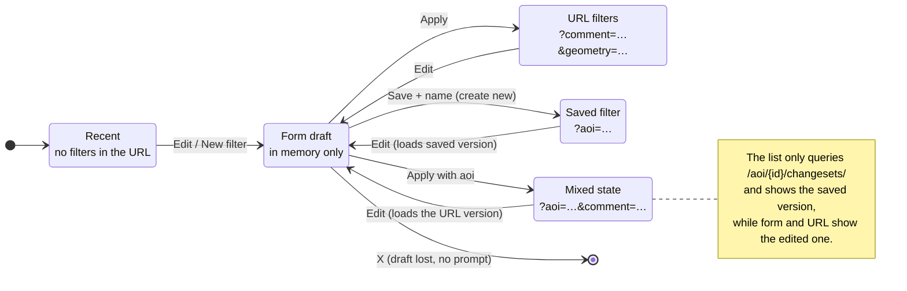
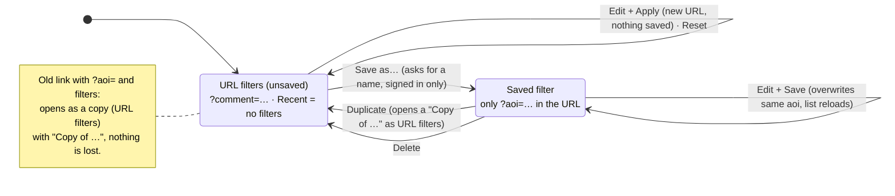

# Filter saving: states before and after

How the filter form (`/filters`) moves between unsaved URL filters and saved filters (AOIs), before and after the rework in `f20a68e` ("Filters form: one source per list, Save overwrites the saved filter, Duplicate opens a copy").

Canonical code: [`src/views/filters.tsx`](../src/views/filters.tsx), [`src/components/filters/filters_header.tsx`](../src/components/filters/filters_header.tsx), [`src/stores/filter-copy-store.ts`](../src/stores/filter-copy-store.ts), legacy link migration in [`src/routes/__root.tsx`](../src/routes/__root.tsx). **Update the "After" diagram when the form's actions change.**

---

## Before: four list states plus a form draft

Problems:

- **Mixed state.** Apply on a saved filter wrote the filters into the URL _next to_ `aoi`. The list ignored them, so it looked saved but showed something else than the form.
- **Save and Apply were separate.** Save asked for the name every time. For a new filter it jumped to the list, for an existing one it silently stayed in the form; it was unclear whether Apply was still needed.
- **Drafts got lost.** The X closed the form without asking.
- Reset led back to Recent from anywhere.

## After: two states, one source per list

What changed:

- **A list comes from the URL or from a saved filter, never both.** Save writes only `?aoi=…`; Apply and Duplicate write only filters without `aoi`.
- **Save overwrites.** In a saved filter, Save is the one main button: it updates that same filter (name included) and shows its list. The name is asked for only once, in "Save as…", and is a plain field afterwards.
- **Duplicate makes URL filters**, shown as "Copy of _name_". "Save as…" suggests "_name_ (copy)". No orphaned saved filters are created.
- **Unsaved changes are shown, not autosaved.** When the form differs from its source, the header says "Unsaved changes" (saved filter) or "Not applied yet" (URL filters). Leaving via X, Reset or another filter asks "Discard unsaved changes?"; a saved filter also offers "Discard changes". Autosave was rejected because every save reloads the list and half-done input (polygon, place search) would go live at once.
